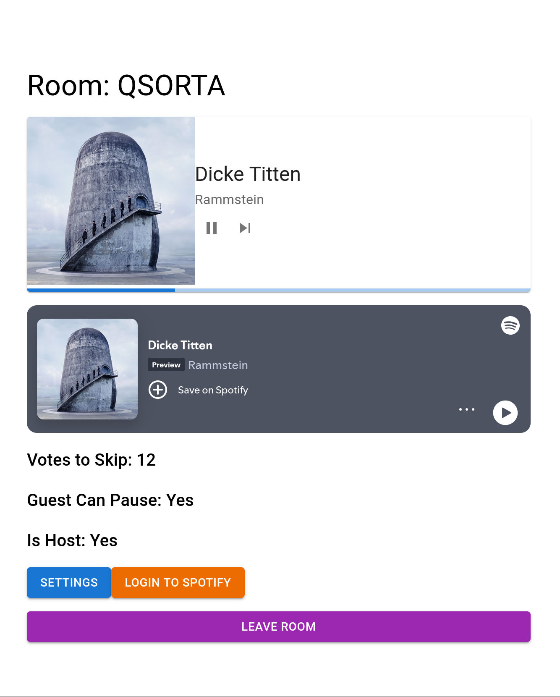

# About

Django + React application. It allows users to create and join rooms were a host can login to spotify
to play music , host can allow users to play/pause music and set votes to skip current song. Users can rejoin
a room if they have the code. Host leaving the room destroys it on the DB.



# Spotify API

- Api changed they require premium to use any player commands


# Build

- port needs to change frontend/src/Env.ts to django current

```
docker-compose up --build
```

# Debug spotify endpoints

- Need to implement expiry tokens , refresh

- if the session is created from react localhost:8000/spotify/ won't carry over the session key
  , the cookie can be copied from http://127.0.0.1:5173/room/ to the view
